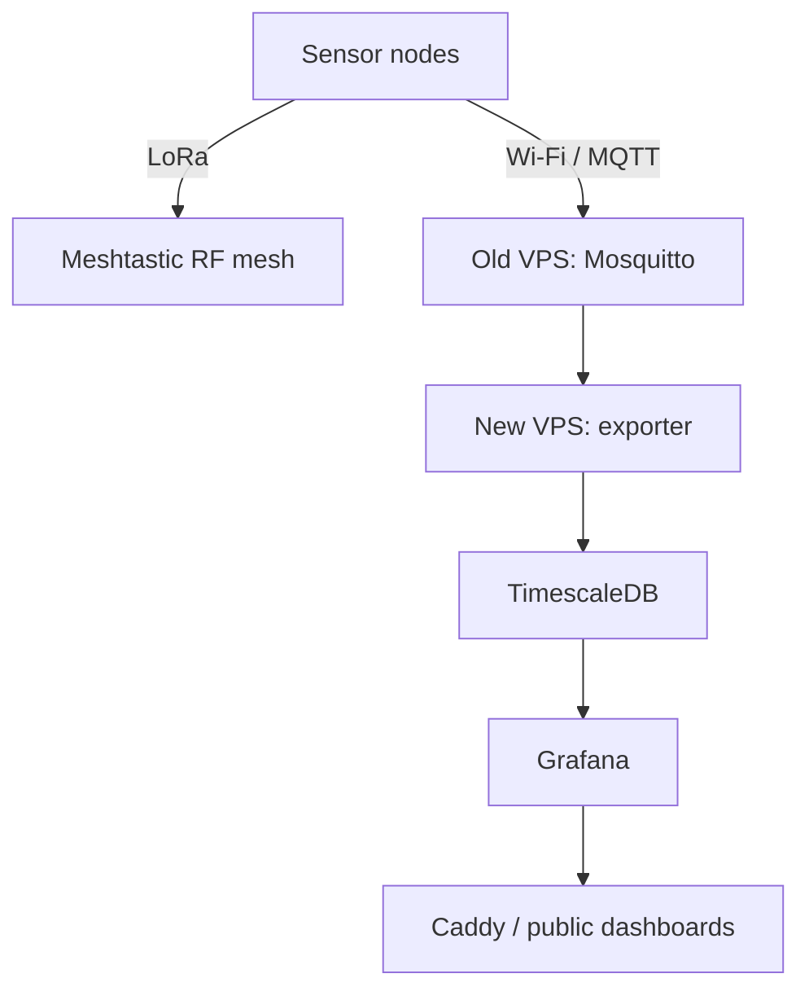

# Reported deployment

Source: S1 and S2 in [sources](sources.md). This describes the state reported after the April 2026 migration, not a fresh operational check.

## Hardware and radio

| Item | Reported information |
| --- | --- |
| Platform | ESP32-based Meshtastic nodes, including Heltec LoRa boards |
| Sensor | BME680 environmental sensing hardware |
| CSC1 | Fixed environmental monitoring node |
| BTL1 | Node used in network tests and weather comparisons |
| BTL2 | Additional node; detailed deployment absent |
| ST1 | Portable/tracker node |
| Radio | Meshtastic LongFast |

Exact firmware versions, wiring, calibration, and per-node configurations are not supplied. A compatible Wi-Fi-enabled Meshtastic board can collect telemetry, transmit via LoRa, and publish MQTT without a separate gateway computer.

## Services after migration

| Location | Components | Evidence |
| --- | --- | --- |
| Original RackNerd VPS | Mosquitto host service, port 1883 | Retained after migration; anonymous subscription rejected |
| New RackNerd VPS | Exporter, PostgreSQL 16/TimescaleDB, Grafana | Docker Compose stack reported operational |
| New VPS host | Caddy and UFW | Caddy configuration copied from old host; full final firewall rules absent |
| Public endpoint | clima.falafel.com.br/sanca | Public Grafana dashboards reported available |

The application directory was reported as `/opt/meshtastic/meshtastic-metrics-exporter`. Compose service names were `exporter`, `timescaledb`, and `grafana`. Named volumes preserve database and Grafana state.

Grafana's published port was observed at `127.0.0.1:3000`. PostgreSQL port 5432 and Grafana port 3000 were not intended for direct public exposure. The new server used UTC.

## Boundaries of the evidence

The reported 30-day retention policy comes from an upstream SQL review; effective policies on the running database were not verified. The exact MQTT topic hierarchy and exporter environment variable names remain unverified. `msh/BR/LongFast/...` appeared as a discussion reference, not a captured configuration.

The migration history provides selected commands and errors but not a reproducible deployment bundle. Compose files, image versions, the complete Caddyfile, and sanitized node/broker configurations still need to be collected.
