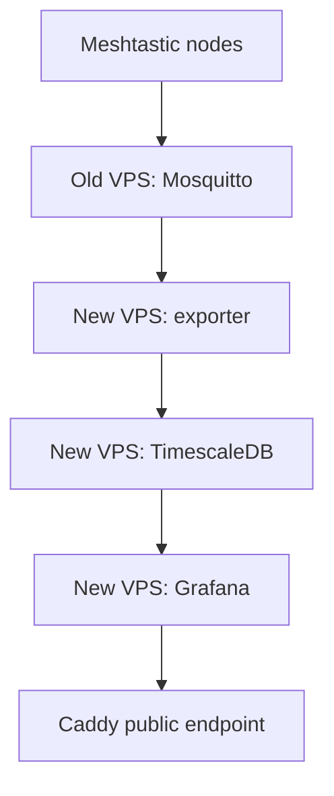

# Clima Sanca — VPS Infrastructure, Grafana and TimescaleDB Migration

> Historical reconstruction from a supplied conversation summary (source S1). Reported results have not been rechecked on the servers. Commands mix actions performed with suggested procedures; read their surrounding status notes before use. This is not a complete installation runbook.

**Documentation source:** ChatGPT troubleshooting and migration session, April 2026  
**Status:** New VPS operational; old VPS retained for MQTT  
**Scope:** Server infrastructure, database migration, monitoring dashboards, disk management and data retention

This document records concrete results and decisions from the conversation. It distinguishes confirmed deployments from recommendations, unverified configurations and future work.

## 1. Project overview

Clima Sanca collects environmental and Meshtastic network telemetry and makes it available through Grafana dashboards.

The deployment uses:

- Meshtastic nodes publishing telemetry over MQTT
- Mosquitto MQTT broker
- Python-based Meshtastic metrics exporter
- PostgreSQL 16 with TimescaleDB
- Grafana dashboards
- Caddy reverse proxy
- UFW firewall
- Docker Compose for the metrics stack

The project initially ran on a small RackNerd VPS. In April 2026, the database became unavailable after the VPS disk filled completely.

The infrastructure was subsequently migrated to a larger RackNerd VPS, while MQTT remained on the original server.

## 2. Hardware and infrastructure

### 2.1 Meshtastic hardware

The broader project uses Heltec ESP32 LoRa boards and environmental sensors.

Known nodes include:

| Node | Role |
|---|---|
| CSC1 | Fixed environmental monitoring node |
| BTL1 | Meshtastic node participating in network tests |
| BTL2 | Additional Meshtastic node |
| ST1 | Portable/tracker node |

The project uses BME680 environmental sensing hardware.

**Scope limitation:** This conversation did not establish new hardware wiring, firmware flashing procedures or sensor calibration steps. Those belong in separate hardware/deployment documentation.

### 2.2 Original VPS

**Confirmed configuration:**

| Property | Value |
|---|---|
| Provider | RackNerd |
| Hostname | `racknerd-5a09466` |
| IPv4 | `OLD_VPS_ADDRESS` |
| Root filesystem | `/dev/vda2` |
| Usable filesystem size | 9.1 GB |
| Annual price | US$10.28 |
| Registration date | 2026-04-08 |
| Next renewal | 2027-04-08 |

The original VPS hosted Mosquitto and the Docker Compose metrics stack.

### 2.3 New VPS

**Confirmed configuration:**

| Property | Value |
|---|---|
| Provider | RackNerd |
| Hostname | `racknerd-bc22d3a` |
| Advertised disk | 100 GB SSD |
| Advertised RAM | 6 GB |
| Advertised CPU | 5 vCPU |
| Filesystem size | 96 GB |
| Operating system selected | Ubuntu 24.04 LTS |
| Server timezone | UTC |

The purchased plan was discussed at approximately US$44 annually.

Following migration:

```text
Filesystem   Size   Used   Avail   Use%
/dev/vda2     96G   6.9G     84G     8%
```

This was the reported operational state of the new VPS.

## 3. Final architecture

The agreed deployment architecture was:




**Confirmed architectural decisions:**

1. Keep Mosquitto on the original VPS temporarily.
2. Move TimescaleDB, Grafana and the metrics exporter to the new VPS.
3. Use Docker Compose for the metrics stack.
4. Keep Caddy and UFW as host services.
5. Use UTC on the server.
6. Minimize installed packages and retained operational logs.
7. Preserve the new VPS for additional experiments, including possible Reticulum services.

The new VPS is not intended to be dedicated exclusively to weather monitoring.

## 4. Software and service locations

### 4.1 Application directory

The Docker Compose project is located at:

```text
/opt/meshtastic/meshtastic-metrics-exporter
```

The directory was copied from the original VPS to the new VPS using `rsync`.

The upstream software discussed in the conversation was:

https://github.com/tcivie/meshtastic-metrics-exporter

This conversation did not establish a separate Git repository containing the Clima Sanca deployment configuration.

### 4.2 Docker services

Observed container names:

```text
meshtastic-metrics-exporter-timescaledb-1
meshtastic-metrics-exporter-grafana-1
meshtastic-metrics-exporter-exporter-1
```

Service names used by Docker Compose:

```text
timescaledb
grafana
exporter
```

Useful commands:

```bash
cd /opt/meshtastic/meshtastic-metrics-exporter

docker compose ps
docker compose logs --tail 100

docker compose up -d
docker compose stop exporter
docker compose down
```

**Important:** `docker compose down` does not remove named volumes unless invoked with volume-removal options.

### 4.3 Docker volumes

Observed named volumes:

```text
meshtastic-metrics-exporter_timescaledb_data
meshtastic-metrics-exporter_grafana_data
```

These contain persistent database and Grafana application data.

Useful inspection commands:

```bash
docker volume ls
docker volume inspect VOLUME_NAME
docker system df -v

du -h -d 1 /var/lib/docker/volumes | sort -h
```

Do not remove these volumes during normal maintenance.

## 5. Completed migration

### 5.1 Base operating system

The new VPS was prepared with a minimal Ubuntu installation.

The setup procedure included:

- OS package updates
- Docker Engine and Compose plugin installation
- UFW configuration
- Caddy installation
- Reduced system journal retention
- Avoidance/removal of Snap where unnecessary
- Reduced Docker log retention

The new VPS was subsequently confirmed operational.

**Verification limitation:** The conversation did not include a final inspection of every installed package or the effective Docker daemon configuration.

### 5.2 Database migration

**Confirmed migration strategy:** Full PostgreSQL/TimescaleDB logical dump and restore.

The original database was:

```text
Database: meshtastic
PostgreSQL: 16
TimescaleDB: extension installed
```

A clean dump was generated on the original VPS:

```bash
docker exec -i meshtastic-metrics-exporter-timescaledb-1 \
  pg_dump -U postgres -d meshtastic \
  > /root/meshtastic_dump.sql \
  2> /root/meshtastic_dump.stderr
```

The dump was transferred to the new VPS using `scp`.

Example destination:

```text
/root/meshtastic_dump.sql
```

#### Important migration discovery

The TimescaleDB container automatically executes initialization scripts on its first startup with an empty database volume.

Observed startup path:

```text
/docker-entrypoint-initdb.d/init.sql
```

The script creates application tables, hypertables, functions, triggers, indexes and retention policies.

Attempting to restore a complete database dump after this script ran produced conflicts, including:

```text
function already exists
relation already exists
duplicate key value violates unique constraint
multiple primary keys
```

**Confirmed finding:** The initialization script does not rerun on ordinary restarts when the PostgreSQL data directory already contains an initialized database.

For a full logical restore, the application initialization script must be disabled during the target database's first initialization.

#### TimescaleDB-specific restoration

The migration also exposed a TimescaleDB restoration issue:

```text
ERROR: table "mesh_packet_metrics" is not a hypertable
```

The restore procedure was amended to use TimescaleDB's restore functions:

```sql
SELECT timescaledb_pre_restore();
```

Restore the full dump:

```bash
cat /root/meshtastic_dump.sql | \
docker exec -i meshtastic-metrics-exporter-timescaledb-1 \
psql -v ON_ERROR_STOP=1 -U postgres -d meshtastic
```

Then:

```sql
SELECT timescaledb_post_restore();
```

**Result:** The new database stack was reported operational after migration. The conversation does not contain a complete successful restore transcript after the final adjustment, so that exact command sequence should be treated as the documented procedure rather than independently verified line by line.

#### Data verification

Useful verification query:

```bash
docker exec -i meshtastic-metrics-exporter-timescaledb-1 \
psql -U postgres -d meshtastic -c "
SELECT MIN(time), MAX(time), COUNT(*)
FROM environment_metrics;
"
```

### 5.3 Grafana migration

Grafana stores application state in its persistent volume.

The migration procedure used a volume archive rather than recreating dashboards manually.

Backup approach:

```bash
docker run --rm \
  -v meshtastic-metrics-exporter_grafana_data:/volume \
  -v /root:/backup \
  alpine \
  tar czf /backup/grafana.tar.gz -C /volume .
```

The archive was transferred to the new VPS.

**Important operational improvement:** Stop Grafana before backing up or restoring its persistent volume, especially if it uses SQLite. This avoids copying a database while it is being modified.

The migration was subsequently reported successful, with the new Grafana deployment online.

### 5.4 MQTT dependency

Mosquitto remained installed on the original VPS as a systemd service.

Confirmed original service:

```bash
systemctl status mosquitto
```

Broker port:

```text
1883/tcp
```

Anonymous MQTT subscription was rejected:

```text
Connection Refused: not authorised
```

This confirmed that broker authentication was enforced.

The new exporter initially failed to connect:

```text
Failed to connect to MQTT broker: timed out
```

The architectural decision was to point the new exporter to the original VPS broker.

The exporter was later reported operational.

**Configuration note:** The actual exporter configuration variable names should be verified against the checked-out source and Compose configuration. `MQTT_HOST` was used illustratively in the migration guide but was not independently verified as the exact variable name.

### 5.5 Caddy migration

The public Grafana endpoint used:

```text
clima.falafel.com.br
```

Caddy was installed as a host service.

Configuration file:

```text
/etc/caddy/Caddyfile
```

After DNS was switched, the new VPS initially ran the default Caddyfile.

Observed listener:

```text
*:80
```

No HTTPS listener on port 443 was initially present.

The user chose to copy the existing Caddyfile from the original VPS rather than create a replacement.

Migration command:

```bash
cp /etc/caddy/Caddyfile /etc/caddy/Caddyfile.bak

scp root@OLD_VPS_ADDRESS:/etc/caddy/Caddyfile \
  /etc/caddy/Caddyfile
```

Validation and restart:

```bash
caddy validate --config /etc/caddy/Caddyfile
systemctl restart caddy
```

Useful diagnostics:

```bash
systemctl status caddy --no-pager
journalctl -u caddy -n 50 --no-pager
ss -tulpn | grep -E ':80|:443'
```

**Confirmed:** The original configuration contained redirect behavior that the user wanted to preserve.

**Not captured:** The complete Caddyfile contents and exact redirect rules.

### 5.6 UFW firewall

The setup procedure specified a default-deny inbound policy:

```bash
ufw default deny incoming
ufw default allow outgoing

ufw allow OpenSSH
ufw allow 80/tcp
ufw allow 443/tcp

ufw enable
```

TimescaleDB port 5432 and Grafana port 3000 were not intended to be publicly exposed.

Grafana was observed with a localhost-only published port:

```text
127.0.0.1:3000->3000/tcp
```

The original VPS retained the externally reachable MQTT listener.

**Not verified:** A complete final comparison of UFW rules on both servers.

## 6. Grafana troubleshooting results

### 6.1 Charts displaying old data

A dashboard displayed:

```text
Data outside time range
```

One source query was:

```sql
SELECT
  "time",
  temperature,
  relative_humidity,
  barometric_pressure,
  gas_resistance,
  iaq
FROM environment_metrics
WHERE node_id = '2697683504'
LIMIT 50;
```

The query had no time filter or explicit ordering.

Consequently, the selected 50 rows were not guaranteed to fall within the dashboard time window.

Recommended correction:

```sql
SELECT
  "time",
  temperature,
  relative_humidity,
  barometric_pressure,
  gas_resistance,
  iaq
FROM environment_metrics
WHERE
  $__timeFilter("time")
  AND node_id = '2697683504'
ORDER BY "time";
```

A separate working query used an explicit time range and selected two node IDs:

```text
2697683504
3127535928
```

The query joined `environment_metrics` with `node_details` to obtain readable node names.

### 6.2 Public dashboard navigation

Links between public dashboards sometimes opened with panels showing no data.

Observed behavior:

- Navigating through the link could produce an incorrect initial display.
- Grafana's internal refresh button did not resolve the issue.
- A full browser refresh did resolve it.

The chosen workaround was to open linked public dashboards in a new tab.

Time-range propagation used:

```text
?from=${__from}&to=${__to}
```

**Unresolved root cause:** A Grafana client-side navigation/state issue was suspected, but no Grafana bug report or upstream confirmation was established.

Future option: use dashboard variables to select nodes without navigating between separate public dashboards.

## 7. Disk exhaustion incident

### 7.1 Initial failure

The original VPS became full:

```text
/dev/vda2  9.1G  9.0G  0  100% /
```

Grafana reported:

```text
failed to acquire connection
FATAL: the database system is not yet accepting connections
SQLSTATE 57P03
```

TimescaleDB repeatedly attempted recovery but failed:

```text
PANIC: could not write to file
"pg_logical/replorigin_checkpoint.tmp":
No space left on device
```

**Confirmed root cause:** PostgreSQL could not complete recovery because the root filesystem had no available space.

### 7.2 Storage investigation

Initial large directories included:

```text
/usr                 3.5G
/var                 4.7G
/var/lib             4.0G
/var/lib/containerd  3.0G
```

Containerd storage was subsequently measured at approximately:

```text
/var/lib/containerd                                  3.3G
/var/lib/containerd/io.containerd.content.v1.content 735M
/var/lib/containerd/io.containerd.snapshotter.v1.overlayfs 2.6G
```

The Docker volumes were relatively small:

```text
Grafana volume       51M
TimescaleDB volume   68M
```

This established that the weather database was not responsible for most disk usage.

### 7.3 Recovery

The following command reclaimed approximately 1.893 GB:

```bash
docker system prune -a -f
```

Unused Docker images, stopped containers and build cache were removed.

The TimescaleDB image was subsequently downloaded again when the stack restarted.

PostgreSQL successfully completed crash recovery:

```text
database system is ready to accept connections
```

A transient TimescaleDB background worker warning appeared during startup, but later job statistics showed successful background job execution.

### 7.4 Additional cleanup

Actions included:

```bash
apt-get clean
journalctl --vacuum-size=30M
```

Disabled Snap revisions were removed.

The remaining Snap installation was later removed from the original VPS.

After these operations, the old server had approximately 1.2 GB available before the migration.

### 7.5 Post-migration cleanup of old VPS

After the new VPS became operational, the old Docker Compose stack was shut down while Mosquitto remained running.

The old server was cleaned further.

Final reported disk usage:

```text
Filesystem   Size   Used   Avail   Use%
/dev/vda2    9.1G   4.3G    4.4G   50%
```

Final directory sizes:

```text
/usr       3.4G
/var       627M
/boot      259M
/root       43M
```

Breakdown of `/var`:

```text
/var/lib    335M
/var/log    150M
/var/cache  142M
```

**Confirmed result:** The original VPS was reduced to approximately 50% filesystem usage and retained for MQTT service.

**Safety note:** Manual deletion of `/var/lib/containerd` was suggested during troubleshooting but should not be used as a routine cleanup procedure. Docker-managed pruning is safer.

## 8. Disk-growth safeguards

### 8.1 Docker log rotation

The new VPS setup guide specified:

```text
/etc/docker/daemon.json
```

With:

```json
{
  "log-driver": "json-file",
  "log-opts": {
    "max-size": "5m",
    "max-file": "2"
  }
}
```

This limits each container's JSON log files to approximately 10 MB, excluding filesystem overhead.

**Important:** Docker daemon defaults generally apply to newly created containers. Existing containers may need recreation for changed log options to take effect.

**Verification pending:** Confirm effective logging configuration for each running container with `docker inspect`.

### 8.2 System journal limits

The migration guide specified a journald override:

```text
/etc/systemd/journald.conf.d/limits.conf
```

With:

```ini
[Journal]
SystemMaxUse=100M
SystemKeepFree=500M
MaxRetentionSec=7day
```

The purpose is to prevent operational logs from consuming unbounded disk space.

### 8.3 Optional cleanup

A weekly Docker cleanup script was proposed:

```text
/etc/cron.weekly/docker-clean
```

Using:

```bash
docker system prune -f
journalctl --vacuum-size=100M
```

**Status:** Proposed; installation was not confirmed.

The supplied attachment ends here mid-sentence. No missing content has been reconstructed.
